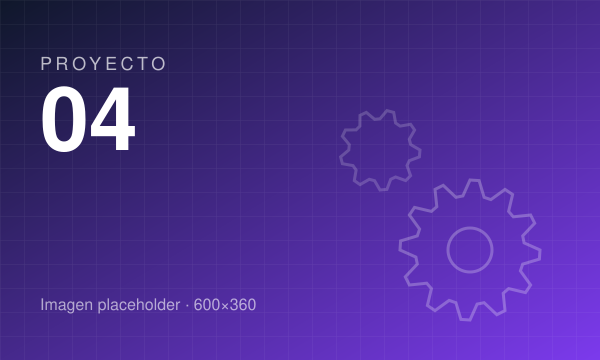

<!-- TODO: reemplaza por una foto o captura real y describe qué muestra -->

## Problema
[Qué problema resuelve el proyecto y en qué parte del proceso aplica.]

## Método
[Sensores, controlador, software y modelo utilizados.]

## Resultado
[Demo, métricas y fotos de la maqueta.]

## Límites y próximos pasos
[Qué falta validar y qué se haría después.]
